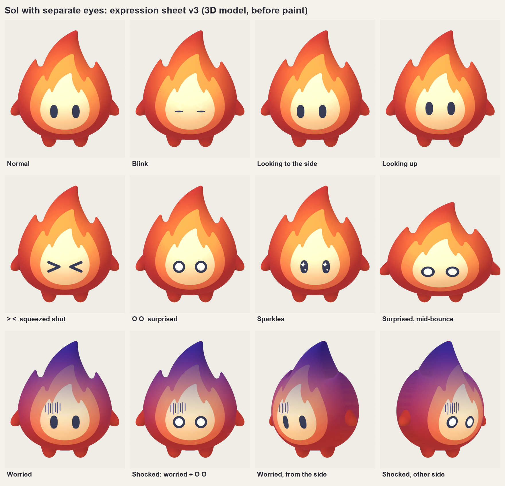
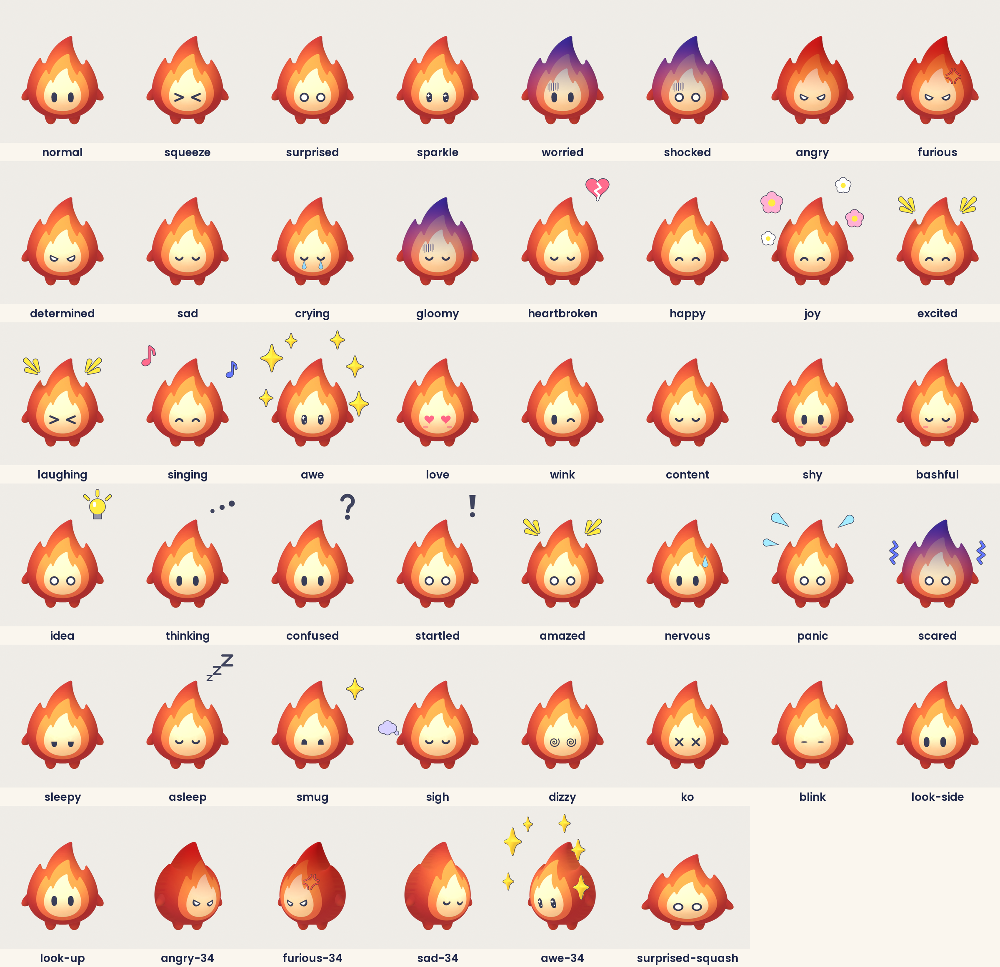

# Sol with separate eyes

Elaine's idea, 2026-11-26: "do u think u can rigg the eyes like seperately like attach a 3d polygon on top when u
do the blender thing". Built the same day. **Approved by Elaine on 2026-11-26**: after seeing sheet version 3 and the bounce test clip
she said "OH ITS PERFECT." The approved copy is frozen in `approved-2026-11-26/`; do not overwrite that folder.
The original model (`../sol.blend`, frozen in `../approved-2026-11-25/`) is untouched; this is a second file
beside it, and it is the one to use from now on whenever Sol shows an expression, blinks or glances.

| File | What it is |
| --- | --- |
| `sol-eyes.blend` | The working file: the approved model plus the new eye shapes and marks (see "More emotions"). The approved Sol with the eyes painted out of his front art and rebuilt as separate pieces. Collection `SOL`, same object names as the approved model plus the eye rig, so a skeleton only has to load this file instead. |
| `sol-eyes-expressions.png` | The sheet, version 3 (v2 with only the tip-down shade, bluer and darker). Version 2 showed: normal, blink, two glances, `> <` with round tips, `O O`, sparkles, worried and shocked (each with the purple shade two ways), side views, one mid-bounce. `sol-eyes-expressions-v1.png` is the first sheet. |
| `eyes_rig.py` | `find_eyes()`, `pose_eyes(eyes, expr, blink, look, size, shade, gloom, marks, t)`, `key_eyes()`, `emotion_at()`. Approved expressions: `normal`, `squeeze`, `surprised`, `sparkle`, `worried`, `shocked`; 32 more below, not approved yet. |
| `build_sol_eyes.py` | Rebuilds `sol-eyes.blend` from `../sol.blend`. `Blender -b ../sol.blend --python build_sol_eyes.py` |
| `render_expressions.py` | Renders the poses for the sheet. |
| `sol-front-texture-noeyes.png`, `eye-outlines.json`, `eye-metrics.json` | His front art with the eyes painted out; the eye outlines traced from the art; where the eyes sit on the model. |
| `sol-gloom-mask-face.png`, `sol-gloom-mask-top.png`, `gloom.json` | Where the worried shade falls (his face only, or from his flame tip down) and where the side lines hang. |

How it works: his normal eye is the exact outline traced from the art, in the art's navy (27, 36, 71), so the
resting face matches the approved model. Each piece is a thin shape pressed onto the front of his body by a
Shrinkwrap modifier, so it follows the curve of his face wherever it slides, and everything hangs off
`RIG_Sol_body`, so the eyes lean, squash and bounce with him. A piece is hidden by scaling it to nothing.

What it allows: planned expressions keyed per frame, blinks timed by us instead of by the painter, and glances
(the eyes slide a little left, right, up or down). The painter still has the last word on each frame, so every
painted frame is still checked.

Changes she asked for after the first sheet (2026-11-26): "can we make the squeezed shut things like rounded
tips"; "for the anime worried try making a pruple gradient that starts from the top of sol to bottom"; "and then
the dashed lines go on the side like this" (her reference: thin lines hanging at the upper side of the face,
above one eye). All three are in version 2. The purple shade is built two ways, on his face only (A) and from
his flame tip down (B), because "the top of sol" could mean either; she has not picked one. Both of her
references pair the worried look with round white eyes, so `shocked` (worried plus `O O`) was added.

Her picks after version 2 (2026-11-26): "i think i like B but lets make the purple like bluer and darker", and
"everytime u swap emotions make sure theres a bounce that acts as a trnasition between one emotion to the other".
Version 3: the shade runs from his flame tip down by default (`shade="top"`), in a deep indigo blue, on the back
of his body as well. `eyes_rig.py` has `emotion_at(t, timeline)`, which gives the bounce for every swap;
`sol-eyes-emotion-bounce-test.mp4` shows it (`render_demo.py` makes it). Sheets v1 and v2 are kept.

## More emotions (2026-11-26, later) — NOT approved yet

Elaine: "can you make an angry and sad emotion for sol 3d ... just like u did before ... and all other emotions that
one could need". Her directions, all built:

- **Angry:** "make the angry face like the OO circle eyes but like they're cut so like its two semicircles that
  rotate down into the middle", and "make sol like have the red gradient instead of purple". So: the ring eye cut to
  its lower half, the flat edge tilted down toward the middle of his face, and the top-down shade in deep red
  (material dial `shade_red`).
- **Sad:** first built as the same cut ring tilted down to the outside (sheet v4). She then asked "can the sad and
  crying just be the black eyes without the white inners", "and same with gloomy", then "wait how about this we do
  two U's like uu" (sheet v5), and last "can the sad and crying eyes be the same as bashful and also heartbroken
  and gloomy". So sad, crying, gloomy and heartbroken use the closed eyes of `bashful` (shape `closed`). The
  shapes `sad` and `u` stay in the file, unused. Sheet v6.
- **Smug:** "turn the eyes around 180 so its like upsidedown gumdrops": the half eye turned half a turn, flat edge
  at the bottom, round on top (shape `dome`). Sleepy keeps the flat-topped `half`.
- **Awe stars, second pass:** "the awe stars look weird". They were stubby straight-sided stars with a lumpy edge
  that tilted as they twinkled. Slim flat sparkles came next (sheet v6); her answer: "the stars are still kind of
  fucked lets see if we can make the star shape and then inflate them". So each star is now a solid: a soft
  rounded four-point star outline puffed out front and back like his own body (`puffy_star`, `puff_into`), with
  the dark edge as a flat plate behind it. Always upright; it only swells and shrinks. Sheet v8.
- **Outlines:** "for all of the elements like tear drops and music notes and like laughin and stuff can we have
  outlines". `mark()` gives every coloured part a thin navy edge (the same shapes a little bigger, behind the
  colour). Not edged: the blush (a soft flush) and marks that are navy already (`?`, `!`, dots, Zs). The second
  music note went from navy to blue so it could have one.
- **Yellow dashes** (excited, laughing, amazed): "can these be like tapered out like the tip of an exclamation
  mark yk also put it closer to sol's body". Each dash is a wedge, thin near him and widening to a round fat end,
  and the two sets sit just above the tips of his side lobes. Sheet v9; `sol-eyes-burst-test-v9.mp4` shows them
  flashing in turn.
- **Light bulb (idea):** "the lightbulb is rly weird ... can we make the metal part like a octagon like rectangle
  octagon". The grey base was a plain square; it is now a rectangle with its four corners cut.
  `sol-eyes-idea-bulb-v10.png` shows it. Then: "lets make it a trapezoid the longer side is toucing the circle and
  then move the lightbulb closer to ignite". The base is now a trapezoid, wide where it meets the glass, and the
  bulb sits nearer his body: `sol-eyes-idea-bulb-v11.png`. Her answer: "good!", then "ok i think the sprites are done":
  she is finished changing the set. It has not been frozen into an approved folder. Sheet v9 still shows the old square base, far from him.
- **Size:** "can you make all particle effects larger". `MARK_SIZE = 1.4` in the build script scales every mark
  (the anger mark 1.25, the blush not at all).
- **Anger mark:** "have that like angry marking thin like this" (her picture: four thin red curves with a dark
  edge). Mark `vein`, on his temple, used by `furious`.
- **Awe:** "use these stars for like awe stricken ... dont use the lines just the stars". Yellow four-point stars
  with a dark edge around him, with the sparkle eyes. Expression `awe`.
- **The rest:** she pointed at a game's list of reaction emotes as the range she means. The marks here are the
  ordinary comic ones (sweat drop, tears, sparkles, light bulb, notes, Zs, "!" and "?"), drawn as our own shapes,
  not copies of that game's icons.

38 expressions, listed in `EXPR` in `eyes_rig.py`: the approved six, then angry, furious, determined, sad, crying,
gloomy, heartbroken, happy, joy, excited, laughing, singing, awe, love, wink, content, shy, bashful, idea, thinking,
confused, startled, amazed, nervous, panic, scared, sleepy, asleep, smug, sigh, dizzy, ko.

- New eye shapes per eye: `angry` (with a white inside), `half`, `dome`, `arc` (^), `closed` (u), `spiral`,
  `cross`, `heart`. The approved six shapes and the indigo shade are built by the same code as before.
- Marks, `SOL_mark_<name>_<n>`: on his body `blush`, `tear`, `sweat`, `vein`; floating on a flat plane just in front
  of him `stars`, `burst`, `flowers`, `exclaim`, `question`, `bulb`, `dots`, `notes`, `zzz`, `brokenheart`, `shiver`,
  `puff`, `spray`. From a three-quarter view the floating ones sit in front of him, not around him.
- `pose_eyes(..., marks=(...), t=seconds)`: `marks` puts any marks on any face; `t` makes them move (stars twinkle,
  tears drip, the vein throbs, the Zs rise). Marks pop with the eyes on the emotion bounce.
- `sol-eyes-emotions-test-v8.mp4` (v4 to v6 are the same run with the earlier sad eyes, stars and mark sizes): 15.6 s, thirteen swaps with the bounce and the moving marks
  (`render_demo.py -- <dir> v4`). `make_sheet.py` lays out the sheet. Sheets v4 to v8 are kept (v7: outlines added, before the bigger marks and inflated stars). Sheet v3 (`sol-eyes-expressions.png`) and the
  approved folder are unchanged; `eyes_rig.py` still drives the approved file.
- Not looked up: the game's own animations. A web search gave no usable descriptions, so the mark motions are from
  her two clips (dashes flashing in turn above the head; flowers drifting around) and ordinary practice.

Still to do when the next episode starts: the painter has not been tried on any of the new faces or marks, and the expression sheet it is given
(the "Due in 5 Minutes" ad used the approved six) shows only those six: upload sheet v4, or a crop of the faces a clip uses.
