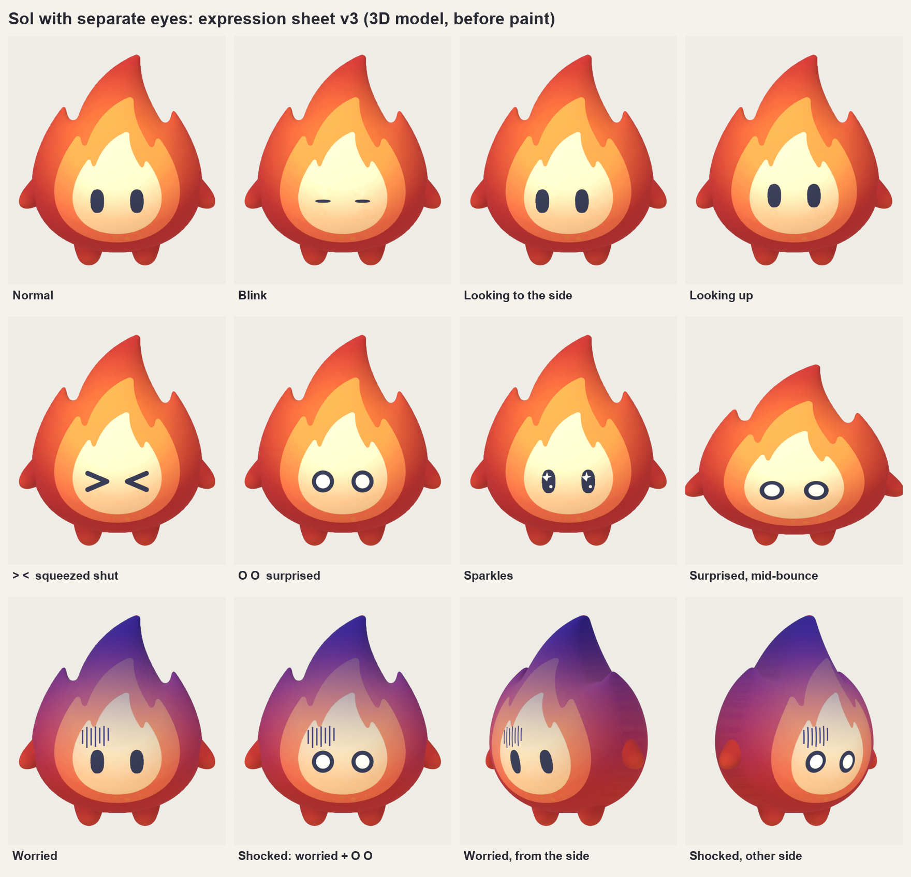

# Sol 3D model: the reference for every clip

Approved by Elaine on 2026-11-25: "YES ... that is what i want, lets save that". Use this Sol, not a
hand-built stand-in and not a description from memory. Read this before blocking a skeleton or writing a
paint prompt that has Sol in it.

## The two models

| Model | Picture | File | Use it for |
| --- | --- | --- | --- |
| **Sol** (arms and legs) | [sol-turnaround.png](sol-3d/sol-turnaround.png) | `../assets/sol-3d/sol.blend`, collection `SOL` | The character in clips. |
| **Sol logo** (body only) | [sol-logo-turnaround.png](sol-3d/sol-logo-turnaround.png) | `../assets/sol-3d/sol-logo.blend`, collection `SOL_LOGO` | The logo mark: the same body with no arms or legs. Saved at Elaine's request the same day. |

The frozen copies are in `../assets/sol-3d/approved-2026-11-25/`. Do not overwrite that folder.
In each `.blend`, the root empty (`RIG_Sol` or `RIG_Sol_logo`) sits on the ground and he is 1.0 tall with legs.
Arms pivot on `RIG_Sol_arm_L` and `RIG_Sol_arm_R`. The legs hang off the root so they stay planted when
the body (`RIG_Sol_body`) leans.

## How he is made (Elaine's method)

1. **Body:** the real outline of `Logo.png` (Sol with no legs) is traced and inflated like a balloon. The
   logo art itself is wrapped on the front, so the layers, colours and eyes are exactly his. The back is
   plain body red.
2. **Legs:** not inflated. Their outline is read off `Mascot.png` row by row and spun into a round limb
   with no reshaping: wide where it joins the body, sides closing in, a blunt rounded tip. They sit exactly
   where the mascot has them. [The check image](sol-3d/sol-legs-check.png) shows the mascot's outline
   drawn over the model's legs.
3. **Arms:** that same leg shape, 1.9 times as long, pointing out and down from his sides.

## Rules that came out of building him

- He is **round**: a plump inflated body, a teardrop from the side and back, like the website's 360
  (`Ignite Website/public/backgrounds/Loading.gif`).
- **Legs are the mascot's own shape.** Narrowed legs and tapered ovals were both rejected as too pointy:
  "not too pointy look at the reference".
- **Arms are the same shape as the legs**, only longer.
- **One simple flame tip**, the one in the art. No curl, twist or swirl.
- Eyes, layers and colours come from the art on his front. Do not redraw them.
- No brown streak along his sides: near the outline, colour comes only from clean interior red.

## Separate eyes (approved 2026-11-26)

Elaine asked for eyes rigged separately so Sol can make anime-style expressions: "rigg the eyes like seperately
like attach a 3d polygon on top". `../assets/sol-3d/eyes/sol-eyes.blend` is the approved Sol with his eyes
painted out of the front art and rebuilt as separate pieces that hug his face. She approved it on 2026-11-26
after the third sheet and the bounce test clip: "OH ITS PERFECT." The frozen copy is
`../assets/sol-3d/eyes/approved-2026-11-26/`.

- Expressions: normal (the exact eyes of the art), blink, glances, `> <` with round tips, `O O` with white
  inside, sparkles, worried (a deep indigo shade from his flame tip down, thin lines at the side of his face),
  shocked (worried plus `O O`).
- Every change of expression goes through a bounce. `eyes_rig.py` has `emotion_at()` for that; the test clip
  is `../assets/sol-3d/eyes/sol-eyes-emotion-bounce-test.mp4`.
- Use this file for new skeletons. The original `sol.blend` stays as the plain reference and for the logo.
- Give the painter the expression sheet as an image reference when a clip uses an expression, along with the
  turnaround sheet.

## Using him

- **Skeleton clips:** append the `SOL` collection instead of building a gray stand-in. Whether a coloured
  Sol in an otherwise gray skeleton is what Elaine wants is still her call; ask before the first clip.
- **Paint passes:** pass `sol-3d/sol-turnaround.png` as an image reference alongside `Mascot.png`.
- **Rebuilding:** see `../assets/sol-3d/README.md`. `compare.py` checks the result against `Mascot.png`.

[Sol beside Mascot.png](sol-3d/sol-vs-mascot.png)

## Poses Elaine has approved

### Hands on hips (approved 2026-11-28)

Elaine, on the "Whole Group Project" ad, cut v13: **"yyayyyyy looks good! lets keep that for the sol model"**. This is
Sol's hands-on-hips pose from now on: confident, sure of himself.

- **Reference frame:** `assets/sol-3d/poses/hands-on-hips-approved-2026-11-28.png` (painted; from
  `episodes/group_project/clips/02-paint-v5.mp4`, frame 140). His two ordinary nubs are tucked down against his sides,
  small, close to the body; he stands tall with plain eyes.
- **In the skeleton:** his own straight nubs, lowered and swung a little forward: `arm_l = arm_r = (-64, 26)` in
  `pose_sol` (rest is `(-40, 0)`), with a small dip-and-plant bounce as they go down, the body stretched a little tall
  (`squash` about -0.08) and tilted back to look up (`pitch` about 10). `clip2()` in
  `episodes/group_project/skeleton/clips.py` is the worked example.
- **In the prompt:** "he plants BOTH nubs on his sides, tucked against his body like hands on hips, puffs up a little
  and tilts back to look up." Give the reference frame as an image reference.
- **Do not build bent arms for it.** Two builds of a two-piece bent arm (`akimbo()` in the same file) were rejected: the
  large one ("wtf are these arms") and the small one (she asked for the first look back). The code is kept but not used.

